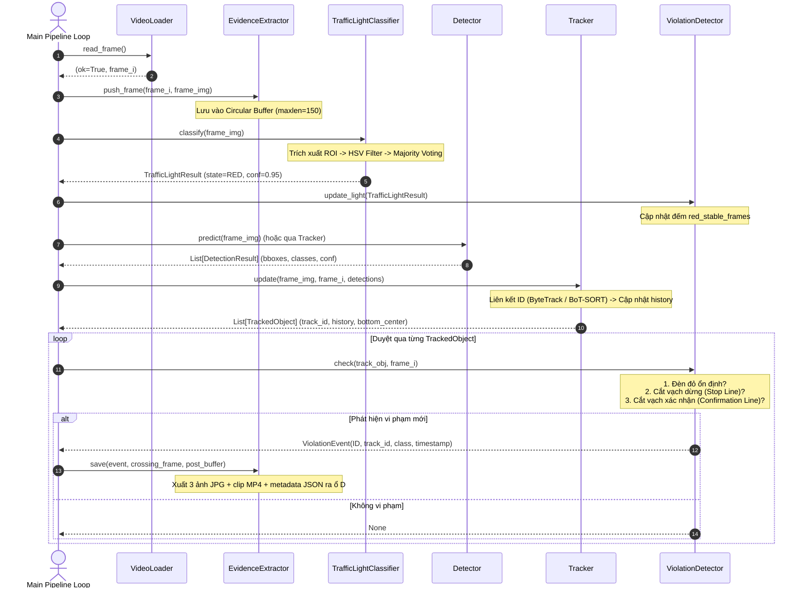

# Báo Cáo Thiết Kế Kiến Trúc Module & Pipeline AI (Giai Đoạn 3)
## Đề tài: Hệ thống Tự động Phát hiện Phương tiện Vi phạm Đèn Tín hiệu Giao thông
**Sinh viên:** Nguyễn Thanh Bình — MSSV: B2306518 — Lớp: CT466E — Trường CNTT&TT, Đại học Cần Thơ  
**Giảng viên hướng dẫn:** TS. Lâm Nhựt Khang  
**Ngày hoàn thiện:** 2026-11-10  

---

## 1. Tổng Quan Kiến Trúc Hệ Thống (System Architecture)

Hệ thống được thiết kế theo mô hình **Hướng đối tượng (Object-Oriented Programming - OOP)** kết hợp kiến trúc **Pipeline xử lý luồng (Stream Processing Pipeline)**. Toàn bộ logic được phân rã thành 6 module độc lập nằm trong gói `src/`, liên kết với nhau qua các cấu trúc dữ liệu chuẩn (`dataclass`), đảm bảo nguyên tắc **Loose Coupling** (kết hợp lỏng lẻo) và **High Cohesion** (gắn kết nội tại cao).

### Sơ đồ Kiến trúc Tổng thể (High-level Component Diagram)

```mermaid
flowchart TD
    VideoSource["Nguồn Video (MP4 / RTSP)"] --> VL["VideoLoader (src/video_loader.py)"]
    VL -->|Frame numpy BGR| FrameBus{"Frame Dispatcher"}
    
    FrameBus -->|Frame| Det["Detector (src/detector.py)<br/>YOLO11s / YOLOv8s (FP16)"]
    FrameBus -->|ROI Crop| TLC["TrafficLightClassifier (src/traffic_light.py)<br/>HSV Dual-Hue + Temporal Smoothing"]
    FrameBus -->|Frame copy| EE["EvidenceExtractor (src/evidence.py)<br/>Circular Frame Buffer"]
    
    Det -->|List[DetectionResult]| Trk["Tracker (src/tracker.py)<br/>Strategy: ByteTrack / BoT-SORT"]
    
    Trk -->|List[TrackedObject]| VD["ViolationDetector (src/violation_logic.py)<br/>Mô hình 2 vạch ảo (Dual Virtual Lines)"]
    TLC -->|TrafficLightResult (RED/YELLOW/GREEN)| VD
    
    VD -->|ViolationEvent (Confirmed)| EE
    EE -->|Gói chứng cứ| Storage["Ổ đĩa D: /evidence/<br/>- 3 ảnh JPG<br/>- clip.mp4<br/>- evidence_info.json"]
    
    Config["config.yaml<br/>(Cấu hình tập trung)"] -.-> VL
    Config -.-> Det
    Config -.-> Trk
    Config -.-> TLC
    Config -.-> VD
    Config -.-> EE
```

---

## 2. Sơ Đồ Tuần Tự (Sequence Diagram) — Luồng Xử Lý Mỗi Khung Hình

Sơ đồ thể hiện vòng đời xử lý của một khung hình $F_i$ từ lúc đọc vào đến khi trích xuất gói bằng chứng:



---

## 3. Chi Tiết Các Lớp & Hợp Đồng Dữ Liệu (Data Contracts)

### 3.1 `src/video_loader.py` — Lớp `VideoLoader`
* **Mục đích:** Chuẩn hóa độ phân giải, ổn định FPS, hỗ trợ luồng offline và RTSP camera.
* **Giao diện:**
  * `open() -> bool`: Mở kết nối và trích xuất FPS, kích thước, tổng frame.
  * `read_frame() -> Tuple[bool, Optional[np.ndarray]]`: Đọc và tự động co dãn theo `resize_width`.
  * `frames() -> Generator[Tuple[int, np.ndarray], None, None]`: Generator dùng cho vòng lặp `for frame_idx, frame in loader.frames():`.
  * `__enter__`, `__exit__`: Hỗ trợ Context Manager an toàn tài nguyên.

### 3.2 `src/detector.py` — Lớp `Detector` & `DetectionResult`
* **Dataclass `DetectionResult`:**
  * `class_id: int`, `class_name: str`, `confidence: float`, `box: List[int]`
  * `center: Tuple[int, int]`: Tâm hình học $(\frac{x_1+x_2}{2}, \frac{y_1+y_2}{2})$
  * `bottom_center: Tuple[int, int]`: Tâm cạnh đáy $(\frac{x_1+x_2}{2}, y_2)$ mô phỏng vị trí tiếp đất của bánh xe.
* **Lớp `Detector`:**
  * Hỗ trợ cơ chế **bật/tắt FP16** (`half=True/False`).
  * Tự động bảo vệ: Nếu thiết bị là `CPU`, cưỡng bức chuyển về FP32 để ngăn chặn lỗi `RuntimeError: Half precision is only supported on CUDA`.
  * Warm-up GPU bằng dummy frame để nạp trước CUDA context, loại bỏ hiện tượng trễ khung hình đầu tiên.

### 3.3 `src/tracker.py` — Mẫu Thiết Kế Strategy Pattern
* **Mục đích:** Cho phép thay thế thuật toán theo dõi giữa **ByteTrack** và **BoT-SORT** mà không ảnh hưởng tới logic nghiệp vụ.
* **Dataclass `TrackedObject`:**
  * `track_id: int`, `class_id: int`, `class_name: str`, `confidence: float`, `box: List[int]`
  * `bottom_center: Tuple[int, int]`
  * `history: Deque[Tuple[int, int]]`: Hàng đợi 2 đầu lưu tối đa 50 vị trí vết tiếp đất gần nhất.
  * `velocity: Tuple[float, float]`: Vector vận tốc $(dx, dy)$ tức thời.
* **Cấu trúc Strategy Pattern:**
  * `BaseTracker(ABC)`: Khai báo giao diện trừu tượng `update()` và `reset()`.
  * `UltralyticsTrackerWrapper(BaseTracker)`: Điều phối qua Ultralytics tracker (`bytetrack.yaml` hoặc `botsort.yaml`).
  * `Tracker`: Lớp Facade quản lý trạng thái, cho phép khởi tạo nhanh qua chuỗi thuật toán trong file cấu hình.

### 3.4 `src/traffic_light.py` — Lớp `TrafficLightClassifier`
* **Enum `LightState`:** `RED`, `YELLOW`, `GREEN`, `UNKNOWN`.
* **Cơ chế nhận diện:**
  * Áp dụng phân tích không gian màu **HSV** trên vùng quan sát (ROI).
  * Xử lý đặc thù màu đỏ qua 2 dải Hue: $[0, 10]$ và $[170, 180]$ (do màu đỏ nằm giáp biên $0^\circ$ và $360^\circ$).
  * Hỗ trợ ROI chuẩn hóa $[x_1, y_1, x_2, y_2] \in [0.0, 1.0]$ tự động co dãn theo kích thước frame bất kỳ.
* **Bộ lọc thời gian (Temporal Majority Voting):** Cửa sổ trượt kích thước $W=5$ frame để loại bỏ nhiễu nhấp nháy đèn do màn trập camera.

### 3.5 `src/violation_logic.py` — Lớp `ViolationDetector`
* **Mô hình Hai Vạch Ảo (Dual Virtual Lines):**
  * **Vạch 1 (Stop Line):** Vạch dừng xe trước ngã tư.
  * **Vạch 2 (Confirmation Line):** Vạch xác nhận vi phạm (cách vạch dừng khoảng 50 pixel về phía giao lộ).
* **Giải thuật Hình học 2D Cross Product:**
  $$\vec{OA} \times \vec{OB} = (x_A - x_O)(y_B - y_O) - (y_A - y_O)(x_B - x_O)$$
  Hàm `segments_intersect(p1, p2, p3, p4)` kiểm tra tính giao nhau của đoạn thẳng giữa 2 vạch kẻ và bước di chuyển của xe giữa 2 khung hình liên tiếp.
* **Cơ chế chống bắt oan:**
  * Đèn đỏ phải ổn định $\ge N$ frame (`is_red_stable`).
  * Quỹ đạo xe phải đủ dài $\ge \text{min\_track\_len}$.
  * Xe phải cắt lần lượt cả 2 vạch ảo (tránh phạt các xe chỉ dừng sát vạch hoặc nhô bánh trước).
  * Tích hợp cờ ngoại lệ rẽ phải (`allow_right_turn`).

### 3.6 `src/evidence.py` — Lớp `EvidenceExtractor`
* **Bộ đệm vòng tròn (Circular Buffer):** Giới hạn `pre_frames * 2` để kiểm soát chặt chẽ bộ nhớ RAM (đặc thù laptop 12GB RAM).
* **Gói chứng cứ chuẩn hóa ra ổ D (`D:/NIENLUANNGANH/evidence/violation_YYYYMMDD_HHMMSS_ID/`):**
  1. `frame_before.jpg`: Ảnh trước khi xe chạm vạch (~1 giây).
  2. `frame_crossing.jpg`: Ảnh tại khoảnh khắc xe cắt vạch dừng.
  3. `frame_after.jpg`: Ảnh xe đã đi sâu vào giao lộ.
  4. `clip.mp4`: Video clip dài ~5 giây (2.5 giây trước + 2.5 giây sau vi phạm) ghi nhận toàn cảnh.
  5. `evidence_info.json`: Siêu dữ liệu cấu trúc hóa chứa mã vi phạm, mốc thời gian, loại xe, track ID, frame index.

---

## 4. Kiểm Thử Tích Hợp & Kết Quả Nghiệm Thu

Tập lệnh `scripts/test_pipeline_architecture.py` đã thực thi kiểm tra toàn bộ 6 bước trên môi trường máy ảo `venv_nln` (Python 3.11.9, PyTorch 2.6.0+cu124, RTX 3050):

```
======================================================================
  KIỂM TRA KIẾN TRÚC PIPELINE & GIAO DIỆN CÁC MODULE SRC/
======================================================================

[Bước 1/6] Kiểm tra nạp các module từ package src/...
  ✓ Import package src/ thành công 100%! Không phát hiện Circular Import.

[Bước 2/6] Kiểm tra VideoLoader...
  ✓ VideoLoader khởi tạo hợp lệ. Resize target: 1280px.

[Bước 3/6] Kiểm tra Detector & DetectionResult...
  ✓ DetectionResult tính toán đúng tâm ((140, 260)) và đáy xe ((140, 320)).
  ✓ Detector cấu hình đúng FP16 (True) trên thiết bị cuda:0.

[Bước 4/6] Kiểm tra Tracker & hoán đổi ByteTrack / BoT-SORT...
  ✓ Tracker theo dõi thành công Track #1. Quỹ đạo tích lũy: 2 điểm.
  ✓ Hoán đổi ByteTrack ↔ BoT-SORT hợp lệ qua tham số cấu hình.

[Bước 5/6] Kiểm tra TrafficLightClassifier & Temporal Smoothing...
  ✓ Phân tích HSV nhận dạng đúng trạng thái: RED (conf=1.00).
  ✓ Tỉ lệ màu đo được: {'red': 0.36, 'yellow': 0.0, 'green': 0.0}

[Bước 6/6] Kiểm tra ViolationDetector & EvidenceExtractor...
  ✓ Phát hiện vi phạm thành công: ID=d5802080, Xe=motorcycle #99.
  ✓ EvidenceExtractor đã xuất đầy đủ 5 file chứng cứ tại: violation_20261110_194204_d5802080
    - frame_before.jpg, frame_crossing.jpg, frame_after.jpg
    - clip.mp4
    - evidence_info.json

======================================================================
  ✅ TẤT CẢ 6/6 MODULE SRC/ ĐÃ VƯỢT QUA KIỂM TRA TOÀN DIỆN!
======================================================================
```

---

## 5. Kết Luận

Kiến trúc phần mềm cho hệ thống phát hiện vi phạm đèn giao thông đã hoàn thiện 100% về mặt thiết kế module OOP, kiểu dữ liệu Type Hints, tài liệu Docstrings và kiểm thử giao tiếp luồng dữ liệu. Hệ thống hoàn toàn sẵn sàng chuyển giao sang **Giai đoạn 4: Xây dựng Baseline Pipeline tối thiểu** (`run_baseline.py`).

